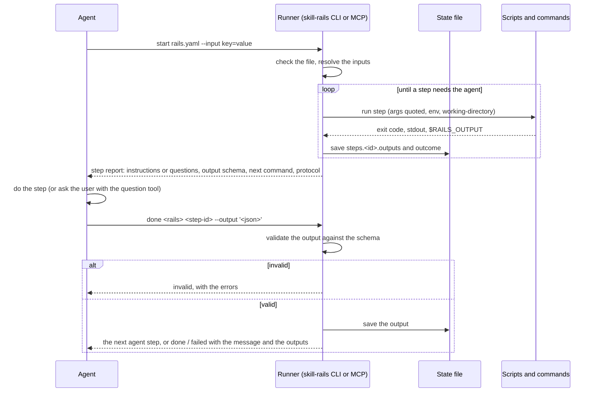

<div align="center">

# skill-rails

### Stop hoping your agent follows the steps. Make it follow them.

[](https://www.npmjs.com/package/skill-rails)
[](LICENSE)
[](package.json)

**Enforced step order · validated outputs · fewer mechanical model turns**

</div>

---

You wrote a great skill.
It has twelve steps, four conditions, and one rule that must never break.
Then the model skips step 7, runs `git log` five times, and invents a flag for `gh`.

**skill-rails puts a skill on rails.**
Code does the steps that are always the same.
The agent does only the steps that need judgment, one at a time.
Agent outputs are checked against their declared JSON Schema before the run goes on. Without an explicit schema, the runner checks only that the output is an object.

## Why use a rails file instead of a Markdown-only skill?

Markdown is a good format for instructions, examples, and judgment. A Markdown skill can already call scripts and keep references in separate files. skill-rails adds an executable contract for how those pieces run together.

| Concern | Markdown-only skill | skill-rails |
|---|---|---|
| Step order | The agent interprets and follows the sequence | The runner selects the next step and rejects submissions for a different step |
| Conditions and gates | The agent evaluates the written rule or calls a script | Expressions decide which steps execute, including failure stops |
| Mechanical work | The agent calls commands or a bundled script | Consecutive shell steps execute without a model turn between them |
| Values between steps | The agent tracks values or reads script outputs | Named outputs are available to later expressions; agent outputs can have JSON Schemas |
| User questions | The agent asks and interprets replies | `ask` defines the questions and validates submitted labels or free-text values |
| Loops and reuse | Instructions or scripts describe the repetition | `foreach`, `repeat`, polling, and nested rails files make the repetition explicit |
| Testing | Scripts can be tested; prompt behavior needs separate evaluation | Fixed agent answers let tests exercise branches, scripts, files, and outputs without a model |
| Inspection and continuation | Depend on the host session and any custom scripts | `status` exposes saved progress and the pending step between calls |

For a repeated release or PR workflow, this means a missing prerequisite can stop the run in code, a malformed output can be rejected before the next command, and a branch can be regression-tested without paying for a model run. Prompts and reference material still belong in Markdown.

The rails file format is the GitHub Actions syntax that you already know: `steps`, `if: ${{ }}`, `run`, `env`, `$RAILS_OUTPUT`.
The agent drives the run from its existing session: you add no new service and no API key. Shell steps execute in the runner process; with MCP, that process has its own configured environment and permissions.

## Before and after

The same skill, "open a pull request", as Markdown and as a rails file.

**Before:** `SKILL.md`, one long prompt.
The model must run every command, remember every value, and respect every condition.

````markdown
## Step 1: Gather the context
Run `git branch --show-current`, `gh pr view` and `git merge-base origin/<base> HEAD`.
Store the branch, the base, the open PR and the commits.
If the branch has no commits ahead of the base, stop: there is nothing to merge.
If the branch is the base branch, stop.

## Step 2: Push
Push the branch with `git push -u origin HEAD`. Never force-push.

## Step 3: Write the PR
Copy the PR template to a temp file, then fill it. Keep every HTML comment.
Write a title under 72 characters, in the format of the recent commits.

## Step 4: Create the PR
If the user wants a draft, add `--draft`.
Run `gh pr create --title "<title>" --body-file <file>` and show the URL.
````

**After:** `rails.yaml` holds the order and the conditions, `scripts/` the commands, and `prompts/` the only part that needs the model.

```yaml
# rails.yaml
name: open-pr
steps:
  - id: context
    run: context.sh                    # scripts/context.sh: branch, base, PR, commits, template
  - if: ${{ !steps.context.outputs.commits }}
    stop: Nothing to merge.
    outcome: failure
  - id: push
    run: push.sh                       # never force-pushes
  - id: body-file
    run: body-file.sh                  # copies the template
  - id: text
    prompt: prompts/text.md            # the agent fills the body and writes the title
    output:
      type: object
      required: [title]
      properties:
        title: { type: string, maxLength: 72 }
  - id: create
    run: create.sh
    env:
      TITLE: ${{ steps.text.outputs.title }}
  - stop: 'PR created: ${{ steps.create.outputs.url }}'
```

```bash
# scripts/context.sh (excerpt)
branch="$(git branch --show-current)"
echo "branch=$branch" >> "$RAILS_OUTPUT"
echo 'commits<<EOF' >> "$RAILS_OUTPUT"; git log "$merge_base..HEAD" --oneline >> "$RAILS_OUTPUT"; echo EOF >> "$RAILS_OUTPUT"
```

```markdown
<!-- prompts/text.md (excerpt) -->
Fill `${{ steps.body-file.outputs.file }}` in place: one sentence on the goal, then 2–4 bullet points.
Write the title in the format of the recent commits:
${{ steps.context.outputs.recent }}
```

What changes:

- The model gets **one step**: the text. The other steps run as code, with no model turn.
- The gate "nothing to merge" is an `if:` that always runs, and the title is checked against `maxLength: 72`.
- The rails file can be tested with no model: see [Testing](#testing).

The agent drives the loop from inside its own session and uses its tools for agent steps. The runner executes shell steps:

```text
agent ── start rails.yaml ──▶ runner  (runs the shell steps, then stops at the first agent step)
agent ◀── { status: step, instructions, output schema } ──
agent ── done <step> <json> ──▶ runner  (validates the output, runs the next shell steps)
agent ◀── { status: done, message } ──
```

## Where the approach holds up—and where it does not

### Why not just write a better Markdown skill?

For a short task, that is often the better choice. A checklist is easy to read and change, and it leaves room to adapt when the work is exploratory. A rails file becomes useful when the same sequence runs repeatedly and a missed gate, malformed value, or unnecessary tool call has a meaningful cost. Maintaining YAML, schemas, scripts, and tests needs to earn its place.

### Why not just write a script?

If all the work is mechanical, write a script. A Markdown skill that calls one well-tested script can already remove most of the model overhead. skill-rails helps when execution must alternate between code and judgment: collect context, ask the user, request a draft, validate its shape, then continue in code. Its value is coordinating those handoffs, rather than replacing shell scripts.

### Does this make the agent deterministic?

It makes the declared step order explicit and runner-enforced. It does not guarantee identical model answers, correct reasoning, or identical results from commands that depend on networks, time, or changing repositories. A schema can check that a title is a string under 72 characters; it cannot establish that the title accurately describes the change. Add domain checks where possible and evaluate agent quality separately.

### Can the agent still skip a rule or claim it did the work?

The runner rejects out-of-order submissions and invalid outputs, but it trusts accepted agent reports. It cannot prove that a prompt was followed, or prevent the agent from acting outside the run. When enabled and trusted, the [question hook](docs/agents.md#question-hook) guards supported completion calls and checks reported answers against recorded native question-tool responses. It controls the steps; it is not a security boundary. Shell steps run with the runner process's permissions.

### What happens after an interruption?

Saved state lets the agent retrieve the pending step and continue between completed calls. It is not a transaction log or an exactly-once execution guarantee: a command can change an external system before the updated state is saved. Make side effects safe to retry or check whether they already happened. State is local, stored in a temporary directory by default, and keyed by project directory and rails name; concurrent runs of the same rails file need separate state directories.

### Will it always be faster or cheaper?

No. Batching mechanical steps can reduce model turns, but each agent handoff still adds work, and research-heavy skills may gain little. Agent installation, tool timeouts, Bash availability, and skill discovery also vary; see [agent compatibility](docs/agents.md).

Start with Markdown and scripts. Add a rails file when repeated handoffs, gates, and testable branches justify the extra structure.

## Faster and cheaper

A skill costs time and money in model turns: each turn sends the context again and waits for the model.
skill-rails removes the turns that need no judgment.

- **Fewer turns.** Consecutive `run` steps execute in one runner call, with no model turn between them.
  A Markdown skill can batch commands too; the runner makes that batching explicit and testable.
- **Smaller context.** `SKILL.md` holds only the start command.
  The agent gets the instructions of one step at a time, and never loads the prompts of the branches that do not run.
- **No interpretation work.** The model does not read the rules to find the next step, evaluate the conditions, or keep values in mind.
  The runner does this in code, and gives each step the values it needs.
- **Short answers.** An agent step reports compact JSON that matches its schema.
  Scripts do the parsing and the formatting that a model otherwise writes token by token.
- **Early failure.** A gate stops the run before the costly steps, and a malformed output is refused at once.
  The agent corrects one step, and does not redo the work of the steps after it.
- **Repeatable tests.** Fixed agent answers let tests exercise the steps without spending model tokens.
  Live paths and costs still depend on agent answers, command results, and external state.

The gain is small when most of the work is research or writing that only the model can do: each agent step is still a model turn.

## Upgrading to 0.4

Update pinned CLI, plugin, and MCP commands to `skill-rails@0.4`. This release renames `flow` to `rails` without aliases: update API parameters and exports, MCP tool names, expression contexts, test keys, and shell output variables (`$RAILS_OUTPUT` and `$RAILS_DIR`). The schema is now `schema/rails.schema.json`. See the [changelog](CHANGELOG.md#040) for the full mapping.

Restart runs saved by 0.3.x and validate each rails file with `skill-rails check` before running it. When upgrading from 0.2, also replace `prompt-file: prompts/text.md` with `prompt: prompts/text.md`.

## Install

As a Claude Code plugin, with the skills and the MCP server:

```text
/plugin marketplace add juanigalan91/skill-rails
/plugin install skill-rails@skill-rails
```

As a Codex plugin:

```bash
codex plugin marketplace add juanigalan91/skill-rails
codex plugin add skill-rails@skill-rails
```

This installs the three skills, the local MCP configuration and the [question hook](docs/agents.md#question-hook). See [Codex setup](docs/agents.md#codex) for local installation and client requirements.

As a CLI or a library (Node 20 or later):

```bash
yarn add skill-rails        # or: npx skill-rails check rails.yaml
yarn skill-rails check rails.yaml
```

```ts
import { start, done } from 'skill-rails';
```

The MCP server works with any MCP client:

```json
{ "mcpServers": { "skill-rails": { "command": "npx", "args": ["-y", "skill-rails@0.4", "mcp"] } } }
```

## Other agents

Codex, Cursor, Copilot in VS Code, Gemini CLI, and OpenCode can use the shared skills through the CLI or local MCP server. See [agent setup and compatibility](docs/agents.md) for configuration, current verification status, and a client smoke test.

## Use

- **Run a skill:** the `run-skill-rails` skill, the MCP tools `rails_start` and `rails_done`, or the CLI.
- **Create a skill:** the `create-skill-rails` skill designs the steps and writes `rails.yaml`, `scripts/` and `prompts/`.
- **Migrate a skill:** the `migrate-to-skill-rails` skill audits the existing rules and rewrites the skill in place, using `rails.yaml` and the shared creation rails file. It creates no sibling copies or backups.

The bundled create and migrate skills run their own rails files. Scripts scaffold a new skill or prepare an existing directory for migration, validate the generated rails file, and run its deterministic tests; prompts handle design, authoring, repairs, and safe smoke runs. The runner skill stays as the Markdown bootstrap. See the [migration audit](docs/skill-migration/README.md).

A skill-rails skill is a folder:

```text
my-skill/
  SKILL.md        # the short loop: start the run, do each step, report it
  rails.yaml       # the order, the conditions and the inputs
  scripts/        # the code of the run steps (in PATH)
  prompts/        # the instructions of the agent steps
```

## How the engine works

The agent never reads `rails.yaml`.
The runner reads it, runs every step that needs no model, and gives the agent one step at a time as JSON.
The agent does that step and reports its output with one command.



### The steps

| Step | Who does it | What the runner does |
| --- | --- | --- |
| `run` | Runner | Runs the command, reads the outputs, and goes on or fails. |
| `set` | Runner | Computes values with expressions. |
| `note` | Runner | Adds a message for the user to the next report. |
| `stop`, `fail` | Runner | Ends the run with a message and an outcome. |
| `foreach`, `repeat` | Runner | Runs the inner steps for each item, or until a condition is true. |
| `uses` | Runner | Runs another rails file with its own inputs, and keeps its outputs. |
| `prompt` | Agent | Gives the instructions and the output schema, and waits for `done`. |
| `skill` | Agent | Gives the skill name and its arguments, and waits for `done`. |
| `ask` | Agent and user | Gives the questions, and waits for the answers. |

A step with `if` runs only when its condition is true.

### The data

Each step reads its values from one context, with `${{ }}` expressions:

| Context | Holds |
| --- | --- |
| `inputs` | The inputs of the run, checked against their types. |
| `steps.<id>` | The `outputs`, the `outcome` (`success`, `failure` or `skipped`) and, for a failed `run` step, `exitCode` and `error`. |
| `item`, `loop` | The current item and the index, the count and the previous result of a `foreach` or `repeat`. |
| `rails` | The name and the folder of the rails file. |
| `env` | The environment. |
| `failure` | The failed step and its error, in `on-failure` steps. |

The outputs of a step come from these places:

- A `run` step: what the command prints (`stdout: text`, `env`, `json` or `jsonl`), or the `KEY=value` lines it writes to `$RAILS_OUTPUT`.
- A `prompt`, `skill` or `ask` step: the JSON that the agent reports, after the check against `output`.
  An `ask` option with a `value` stores the value in place of the label.
- A `uses` step: the `outputs` that the other rails file declares.

Values go into a step in these ways:

- A `run` step gets them as `args` (each one quoted) or `env`: the command text holds no expression, so a value cannot inject shell code.
- A `prompt` step gets them in its instructions, or as a `with` map that the runner adds as YAML after the instructions.
- A `skill` step gets them as its `with` arguments.
- A `uses` step gets them as the `with` inputs of the other rails file.

At the end, the run gives back its own `outputs` in the `done` or `failed` report.

### The state

The runner saves the run after each step in a JSON file: `$SKILL_RAILS_STATE_DIR`, by default `skill-rails` in the system temporary folder.
The file name holds a hash of the project folder and the name of the rails file, so two projects can run the same skill at the same time.
The state holds the pending step, the results of the done steps, and one frame per nested rails file and per loop iteration.
`status` prints it, `reset` deletes it, and `record` and `trace` read it after the run.
Because each `done` call reads and writes the file, an interrupted session continues from the pending step.

## Testing

You can test the step order and the branches of a skill with no model by supplying fixed agent answers. Use fixtures and stub commands to control external dependencies; this does not evaluate the quality of real model answers.
A test gives the answers that the agent would give, and the runner does the rest for real: scripts, conditions, outputs and files.

```yaml
# tests/open-pr.test.yaml
rails: ../rails.yaml
path: [stubs]                       # a stub gh, so the test never calls GitHub
setup: |                            # a local remote and a branch with one commit
  git init -q --bare "$(mktemp -d)/origin.git" ...
tests:
  - name: unattended, new draft PR
    inputs: { auto: true }
    answers:
      text: { title: 'feat: add a' }
    expect:
      status: done
      message: 'PR created: https://github.com/acme/app/pull/7'
      steps: { draft: skipped, create: success }
```

```text
$ skill-rails test
✓ interactive, new draft PR  (examples/open-pr/tests/open-pr.test.yaml, 2 agent steps, 1308 ms)
✓ unattended, no questions   (examples/open-pr/tests/open-pr.test.yaml, 1 agent steps, 640 ms)
✓ stops on the base branch   (examples/open-pr/tests/open-pr.test.yaml, 0 agent steps, 494 ms)
```

A test fails when the run asks for a step that has no answer, when an answer is never used, when an answer does not match its schema, or when the result is not the expected one.
See [Testing](docs/testing.md).

## Tests and evals

A skill-rails test replaces the model with fixed answers, and runs the real rails file.
It proves the step order, the gates, the failure paths, the scripts, the files, and the contracts with the callers.
It costs no tokens, gives the same result on each run, and can block a merge.
It does not prove the quality of the model's judgment, that an agent follows the protocol, or that the host picks the skill.

An eval runs a real model and grades its output.
It tests judgment, costs tokens, and can give a different result on each run.

A rails file makes evals smaller:

- Use deterministic tests for scripts and gates; keep fixtures and stubs representative.
- Each prompt step is a small eval unit, with fixed instructions, a rendered context and an output schema.
- The schema makes the structure checks free.
- The runner enforces submitted step order; evaluate judgment and protocol compliance separately.

The tools:

| Tool | Use |
|------|-----|
| Fixed answers | Every commit: the paths of the rails file, with no model. |
| Live steps and `judge` | Evaluate one step in its real context, with a rubric. |
| `mode: agent` | A protocol smoke run on each host, and trigger checks. |
| `skill-rails record` | A real run becomes a regression test. |
| `skill-rails trace` | Real runs become an eval dataset, one line per step. |

Host-level skill-selection evals are complementary: they check whether the agent picks the skill for the right requests.
See [Testing](docs/testing.md).

## CLI

```text
skill-rails start <rails.yaml> [--input <key>=<value> ...]   check the rails file, reset the state of the run, print the first agent step
skill-rails done <rails> <step-id> [--output <json> | -]     record the output of a step, print the next step
skill-rails done <rails> <step-id> --fail <reason>           end the run with an error
skill-rails status <rails>                                   print the current step and the step results
skill-rails reset <rails>                                    delete the state of a run
skill-rails check <rails.yaml>                               check a rails file without running it
skill-rails test [<file or folder> ...] [--live] [--agent <command>]   run the tests; --live also runs the tests that need a real agent
skill-rails record <rails> [--out <file>]                    write a test file from a run
skill-rails trace <rails>                                    print one JSON line per agent step of a run
skill-rails mcp                                              run the MCP server on stdio
```

## Documentation

- [The rails file format](docs/format.md): steps, expressions, outputs, and the protocol.
- [Testing](docs/testing.md): answers, fixtures, stubs and expectations.
- [Agent compatibility](docs/agents.md): setup for other agents and verification.
- [Examples](examples/): `hello` and `open-pr`.

## Security

- A `run` command cannot hold `${{ }}`: values go through `env`, so a commit message or a title cannot run as shell code.
- The runner runs the scripts of the rails file with the permissions of the user who starts it.
  Read a rails file and its scripts before you run them, as you read any script.

## Related projects

- [claude-workflow](https://github.com/AxGord/claude-workflow): YAML state machines that a Claude Code agent moves through with an MCP server.
  skill-rails adds schema-validated outputs, user questions, and the GitHub Actions syntax.
- [Archon](https://github.com/coleam00/Archon) and [GitHub Agentic Workflows](https://github.com/github/gh-aw): the runner starts the agent.
  In skill-rails, the agent drives the runner from inside its own session.
- [Goose recipes](https://github.com/aaif-goose/goose): YAML recipes with structured output.

## Contributing

```bash
yarn install
yarn lint
yarn typecheck
yarn test
```

`yarn lint` checks YAML syntax throughout the repository and validates the keys and types of rails files against the shared schema. CI and npm pre-publish checks run it too. VS Code and Cursor users can install the recommended YAML and ESLint extensions for diagnostics and completion; see [YAML linting](docs/format.md#yaml-linting). The development lint plugins require Node 20.19+, 22.13+, or 24+.

## License

MIT
