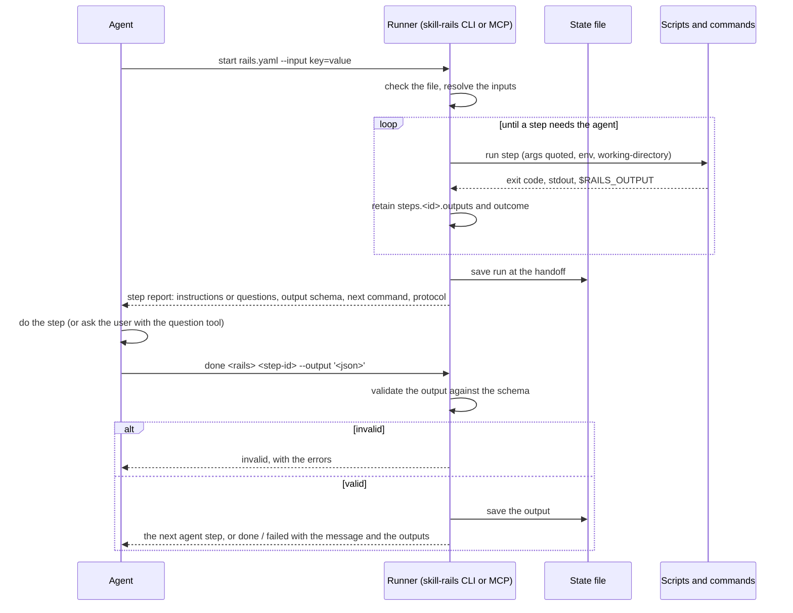

# How the runner works

[Back to README](../README.md)

The runner interprets `rails.yaml`; the agent does not need to read it to execute the protocol.
The runner reads it, runs every step that needs no model, and gives the agent one step at a time as JSON.
The agent does that step and reports its output with one command.

## The steps

| Step | Who does it | What the runner does |
| --- | --- | --- |
| `run` | Runner | Runs the command, reads the outputs, and goes on or fails. |
| `set` | Runner | Computes values with expressions. |
| `note` | Runner | Adds a message for the user to the next report. |
| `stop`, `fail` | Runner | Ends the run with a message and an outcome. |
| `foreach`, `repeat` | Runner | Runs the inner steps for each item, or until a condition is true. |
| `uses` | Runner | Runs another rails file with its own inputs, and keeps its outputs. |
| `prompt` | Agent | Gives the instructions and the output schema, and waits for `done`. |
| `skill` | Agent | Gives the skill name and its arguments, and waits for `done`. |
| `ask` | Agent and user | Gives the questions, and waits for the answers. |

A step with `if` runs only when its condition is true.

## The data

Each step reads its values from one context, with `${{ }}` expressions:

| Context | Holds |
| --- | --- |
| `inputs` | The inputs of the run, checked against their types. |
| `steps.<id>` | The `outputs`, the `outcome` (`success`, `failure` or `skipped`) and, for a failed `run` step, `exitCode` and `error`. |
| `item`, `loop` | The current item and the index, the count and the previous result of a `foreach` or `repeat`. |
| `rails` | The name and the folder of the rails file. |
| `env` | The environment. |
| `failure` | The failed step and its error, in `on-failure` steps. |

The outputs of a step come from these places:

- A `run` step: what the command prints (`stdout: text`, `env`, `json` or `jsonl`), or the `KEY=value` lines it writes to `$RAILS_OUTPUT`.
- A `prompt`, `skill` or `ask` step: the JSON that the agent reports, after the check against `output`.
  An `ask` option with a `value` stores the value in place of the label.
- A `uses` step: the `outputs` that the other rails file declares.

Values go into a step in these ways:

- A `run` step gets them as `args` (each one quoted) or `env`. The command text holds no expression; quote shell variable expansions and avoid evaluating untrusted values as code.
- A `prompt` step gets them in its instructions, or as a `with` map that the runner adds as YAML after the instructions.
- A `skill` step gets them as its `with` arguments.
- A `uses` step gets them as the `with` inputs of the other rails file.

At the end, the run gives back its own `outputs` in the `done` or `failed` report.

## The state

The runner saves the run when a `start` or `done` call returns, in a JSON file under `$SKILL_RAILS_STATE_DIR`, by default `skill-rails` in the system temporary folder.
The file name holds a hash of the project folder and the name of the rails file, so two projects can run the same skill at the same time.
The state holds the pending step, the results of the done steps, and one frame per nested rails file and per loop iteration.
`status` prints it, `reset` deletes it, and `record` and `trace` read it after the run.
Because each completed `done` call reads and writes the file, an interrupted session can retrieve the last saved pending step. This is not an exactly-once execution guarantee: a command can change an external system before the state is saved. Make side effects safe to retry. Concurrent runs with the same project and rails name need separate state directories.

## TypeScript rails files

`rails.ts` uses the same reports and state handoffs. Its execution model replays the function using recorded step results; see [TypeScript rails files](format.md#typescript-rails-files) for the replay rules and constraints.

See [Format and protocol](format.md) for the full syntax and [CLI and API](cli.md) for driving the runner manually.
